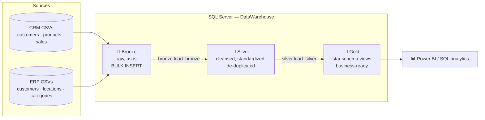
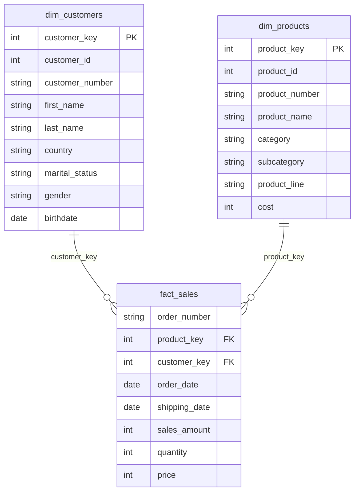

# 🏛️ SQL Data Warehouse — Medallion Architecture (SQL Server)

End-to-end data warehouse that consolidates **CRM** and **ERP** sales data into an analytics-ready **star schema**, using a **Bronze → Silver → Gold** (Medallion) architecture in SQL Server.


---

## 📐 Architecture



| Layer | Object type | Load method | Purpose |
|---|---|---|---|
| **Bronze** | Tables | Full load (truncate + `BULK INSERT`) | Raw copy of source files for traceability |
| **Silver** | Tables | Full load (truncate + insert) via stored procedure | Cleansing, normalization, de-duplication, derived columns |
| **Gold** | Views | — | Star schema for reporting (`dim_customers`, `dim_products`, `fact_sales`) |

## ⭐ Data Model (Gold)



Full column descriptions: [`docs/data_catalog.md`](docs/data_catalog.md).

## 🧹 Data Quality Rules Applied (Silver)

- **De-duplication** — keep the latest record per customer (`ROW_NUMBER()` over `cst_create_date`).
- **Standardization** — codes mapped to readable values (`M/F` → `Male/Female`, `S/M` → `Single/Married`, `DE/US` → country names).
- **Data enrichment** — `cat_id` derived from `prd_key` to join CRM products with ERP categories.
- **Historization fix** — product end dates recomputed with `LEAD()` to remove overlapping validity ranges.
- **Validation** — invalid dates (`0`, wrong length) → `NULL`; future birthdates → `NULL`; inconsistent `sales ≠ quantity × price` recalculated.
- **Integration** — gender taken from CRM (master) with ERP as fallback.

Quality checks for each layer live in [`tests/`](tests).

## 📂 Repository Structure

```
sql-data-warehouse-project/
├── datasets/                  # source CSVs (CRM & ERP) — see "How to run"
├── docs/
│   ├── data_catalog.md        # gold layer column definitions
│   └── naming_conventions.md
├── scripts/
│   ├── init_database.sql      # creates DataWarehouse DB + bronze/silver/gold schemas
│   ├── bronze/
│   │   ├── ddl_bronze.sql
│   │   └── proc_load_bronze.sql
│   ├── silver/
│   │   ├── ddl_silver.sql
│   │   └── proc_load_silver.sql
│   └── gold/
│       └── ddl_gold.sql
└── tests/
    ├── quality_checks_silver.sql
    └── quality_checks_gold.sql
```

## ▶️ How to Run

1. Install **SQL Server** (Express/Developer) and **SSMS** or Azure Data Studio.
2. Put the CRM/ERP CSV files in `datasets/` and update the `BULK INSERT` path in `scripts/bronze/proc_load_bronze.sql`.
3. Run the scripts in order:

```sql
-- 1. Database & schemas  (⚠️ drops DataWarehouse if it exists)
:r scripts/init_database.sql
-- 2. Tables
:r scripts/bronze/ddl_bronze.sql
:r scripts/silver/ddl_silver.sql
-- 3. Procedures
:r scripts/bronze/proc_load_bronze.sql
:r scripts/silver/proc_load_silver.sql
-- 4. Load
EXEC bronze.load_bronze;
EXEC silver.load_silver;
-- 5. Gold views
:r scripts/gold/ddl_gold.sql
-- 6. Validate
:r tests/quality_checks_silver.sql
:r tests/quality_checks_gold.sql
```

(`:r` requires SQLCMD mode in SSMS — or just open and execute each file in that order.)

## 🛠️ Skills Demonstrated

`Data Warehousing` · `Medallion Architecture` · `ETL with T-SQL` · `Stored Procedures & error handling` · `Window functions` · `Star schema / dimensional modeling` · `Data quality testing`

## 👤 Author

**Aiman Makhrout** — Data & AI Engineer · Master's student in Data Science & Actuarial Science (UH1)
[GitHub](https://github.com/aimanmakhrout) · aimanmakhrout@gmail.com

## 📄 License

MIT — see [LICENSE](LICENSE).
